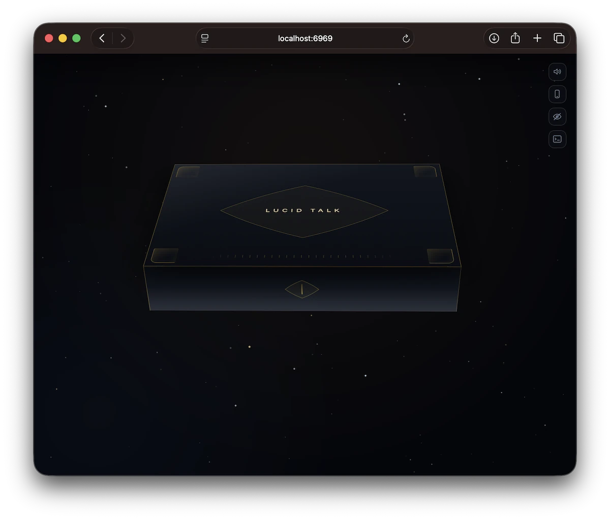
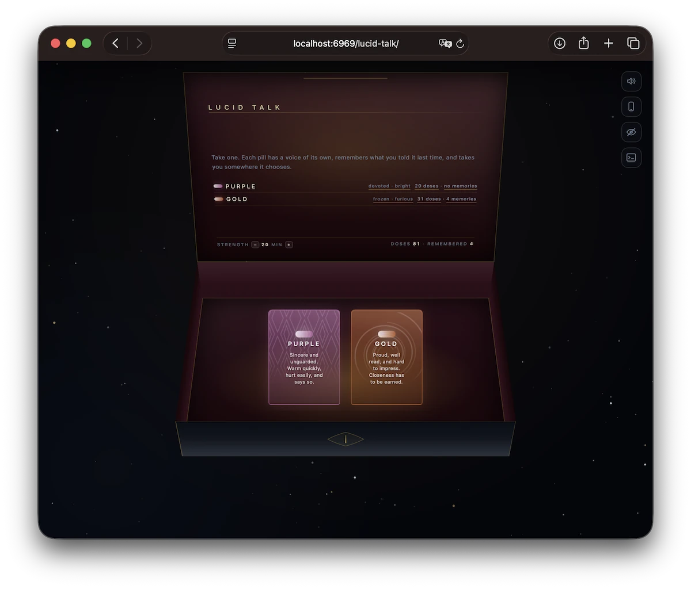

<p align="center">
  
</p>

<h1 align="center">L U C I D &nbsp; D R E A M</h1>

<p align="center"><b>Local AI Games</b></p>

## LUCID TALK

A box of digital drugs for an audio experience with gaming elements.

<p align="center">
  
  
</p>

Take a pill and you are in a room with somebody in it — sincere and unguarded,
or proud and hard to impress, and more flavors coming soon.

Choose a dose strength and let the pill carry you away. Give it a seed by
touch, talk, or typed word, then press Play. You can Pause, rewind (Again), or
fast forward (Skip) — it's like a tape player. Steer the conversation at any
moment with an opinion, an inquiry, or appreciation. Let it take you to the
lucidity of the moment.

The pill remembers things about you, has a character of its own, and its own
appreciation of how you two stand. As that standing changes, so does the
room — the temperature, the palette, the look of it. You can take the pill
many times and likely get yet another surprise or angle. Nothing leaves the
machine.


<p align="center">
  
  
</p>


---

## SYSTEM REQUIREMENTS

Read this part like it is 1996, because it matters as much as it did then.

|              | REQUIRED                                   |
| ------------ | ------------------------------------------ |
| **Computer** | Apple Silicon Mac                          |
| **System**   | macOS 14 or later                          |
| **Memory**   | 16 GB unified; 32 GB for the large model   |
| **Disk**     | 40 GB free, for the models                 |
| **Runtime**  | Python 3.12, and Node 24 to build the page |
| **Display**  | any browser from this decade               |
| **Sound**    | speakers or headphones — headphones better |
| **Network**  | once, to download the models. Never again  |
| **Graphics** | none — Apple Silicon is the graphics card  |

The language model ships in three sizes. All three are installed; setup
picks by memory, `/ai_model_size` in the console switches any time.
Memory and standing stay — only the writer changes.

|        | model      | holds  | needs | first word |
| ------ | ---------- | ------ | ----- | ---------- |
| **lg** | 27B, 4-bit | ~23 GB | 32 GB | ~3-4 s     |
| **md** | 9B, 4-bit  | ~12 GB | 16 GB | under 1 s  |
| **sm** | 4B, 4-bit  | ~9 GB  | 8 GB  | under 1 s  |

Holds = language model + recognizer + voice, on the app's own meter;
leftover is macOS, a browser, the prompt cache. Mic off → no recognizer;
muted room → no voice. The large one starts speaking as soon as the first
sentence exists.

They are not three speeds of the same model.

- **lg — immersion (32 GB).** The model the game was written for.
  Character, place, and what you just introduced stay true together.
  The model plays along: a surprise is answered in character, not
  refused. More than two people hold. It reads the kind of moment you
  are in, not every sentence as a command.
- **md — balanced (16 GB).** Fast enough to feel like a conversation,
  and it uses what it remembers. The register narrows — jealous, one
  note. Spring something mid-scene and it closes on the first try,
  usually as something done to the model; standing jumps. Name the
  premises before you start.
- **sm — fastest (8 GB).** Instant, long, and the model is gone:
  invents, repeats, narrates from outside, same narrow jealous note.
  A core voice shows up; the rest of the persona does not. Rooms and
  voice still run. Not an evening.

**Not supported:** Intel Macs, Windows, Linux, phones on their own. The whole
thing is built on Apple's MLX, which is Apple Silicon or nothing. A phone joins
in as a second screen — see ON YOUR MAC — but it is not the Mac that runs
this.

---

## WHAT'S IN THE BOX

- **The Lucid Dream machine** — one language model, one ear, one voice, and a console to
  watch them by. It knows nothing about any game.
- **A shelf of games.** So far: **Lucid Talk**, the box of pills and the rooms
  behind them.
- **The rooms** — drawn in 3D in your browser, lit by how the pill is holding
  you, with things in them you can move.
- **The wiring** — ear, mind and voice joined so they behave like one person
  you can talk over, interrupt, and be interrupted by.
- **The same game on your phone**, running its own conversation from the other
  end of the sofa.
- **Every conversation on disk**, in a directory you can copy, carry or burn.

---

## INSTALLING

```sh
git clone <this repository>
cd lucid-dream
./setup.sh
./run.sh
```

`setup.sh` checks the Mac, the venv, ~31 GB of models (three language
sizes, the recognizer, the voice), the page, then the tests. Safe twice:
skips what is there; a newer model fetches only that. `--check` reports;
`--prune` removes what nothing uses.

No account for the default models (Apache-2.0 / CC-BY-4.0). A gated model of
your own needs a Hugging Face login; the script says so if it hits one.

`run.sh` prints two addresses; open the one marked **this Mac**,
`http://localhost:6969`, in your browser. Models take a few seconds to warm;
first word is in the table above.

By hand, or with an agent: **[AGENTS.md](AGENTS.md)**.

> Read AGENTS.md in this repository and set the app up on my Mac.

---

## ON YOUR MAC

- **Microphone** — off until you turn it on. Typing always works.
- **Headphones** — better. On speakers, Safari and Chrome cancel echo; Firefox
  on a Mac currently does not.
- **Phone** — the whole page over wifi, out of the box: another player at
  the same Mac. For it to *hear* you,
  `./tools/phone.sh` and the [three taps](MANUAL.md#your-phone).
- **Another player** — `./run.sh --user pete`. Separate memories, no password.
- **Your own** — a character is tuned in the game: `/persona_set` opens its
  words, `/persona_tune` its settings, and what you write is yours, kept beside
  your memories. A voice is a six-second clip you have the rights to.

**[MANUAL.md](MANUAL.md)** — play, write, remember, the phone, where yours
lives on disk.

---

## STANDING ON

[MLX](https://github.com/ml-explore/mlx) ·
[mlx-audio](https://github.com/Blaizzy/mlx-audio) ·
[mlx-vlm](https://github.com/Blaizzy/mlx-vlm) ·
[Parakeet](https://huggingface.co/mlx-community/parakeet-tdt-0.6b-v2) ·
[Chatterbox](https://huggingface.co/mlx-community/chatterbox-turbo-fp16) ·
any [MLX chat model](https://huggingface.co/mlx-community) you like.

In the browser: [React](https://react.dev) ·
[three.js](https://threejs.org) · [Rapier](https://rapier.rs) ·
[Vite](https://vite.dev).

They do not talk to each other. This is the wiring: barge-in, speaking before
the sentence is done, not answering its own voice, remembering when the window
runs out.

---

## LICENSE

**[PolyForm Noncommercial 1.0.0](LICENSE).** Source-available, not open source.
Play it, read it, change it, share it — not commercially.

The models are not mine and do not ship with this.
**[THIRD-PARTY.md](THIRD-PARTY.md)** lists the rest.

**Patches: the machine, not the art.** A Linux port, another accelerator, a
better model — wanted. The games, the people in them, the writing and the look
are not. Sign-off in **[CONTRIBUTING.md](CONTRIBUTING.md)**.
