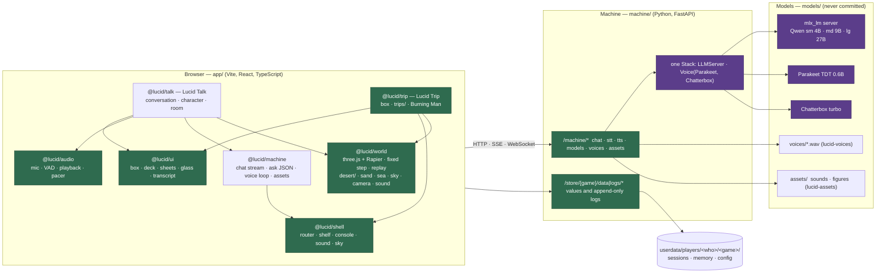
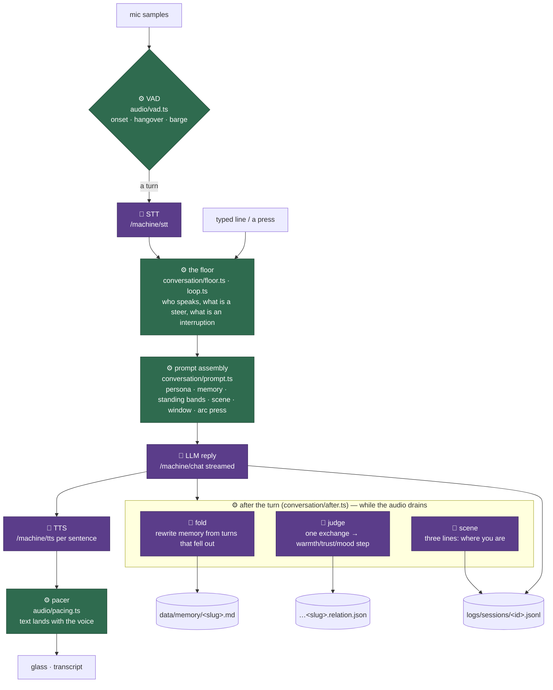
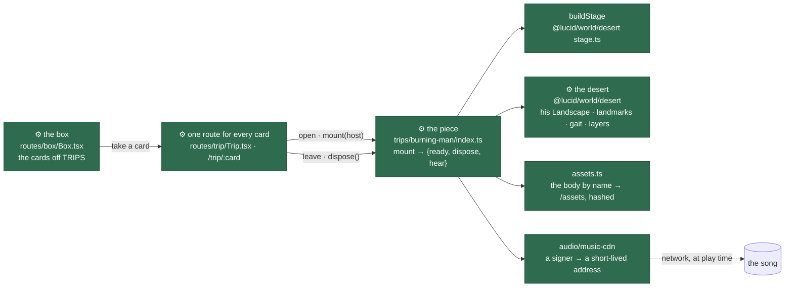

# Lucid Dream — architecture snapshot

*Taken 2026-09-09 at commit `ac9bef6` on `local`. A snapshot, not a spec: it says where the system stands so that new ideas can be placed against what already exists. When the code and this page disagree, the code is right and this page is stale. Lucid Trip's parts (sections 1, 4–8) were rewritten on 2026-10-07, when Burning Man came in and the walk left, and again the same night, when the desert moved out of Burning Man into `@lucid/world`.*

**How to read it.** The whole point of this document is one distinction, drawn everywhere it applies:

| mark | meaning |
| --- | --- |
| 🧠 **model loop** | a step where a language model, the recognizer or the voice decides or produces something. Slow (seconds), non-deterministic, may fail, always has a fallback or a silence. |
| ⚙️ **code loop** | a step decided by arithmetic in the page or the machine. Fast (a frame), deterministic, keyed rather than random, replayable from a log. |

In the diagrams, purple is the model and green is code. Every loop below has a card in the same shape: what starts it, what the model decides, what the code decides, how long it takes, and what happens when the model does not answer. File paths are the way in.

---

## 1. The whole thing in one picture

Three processes on one Mac. The browser runs the page — the shell, the mechanism packages and the two games — and is where every queue, every decision and every save lives. The machine is a FastAPI process that owns exactly one language model, one recognizer and one voice, and knows nothing about any game. The language model is a child process the machine supervises.



**The rule the shape comes from.** The machine has no game word in it; the shell knows no game; a game imports another game only through a short list of `MECHANISM` subpaths enforced by lint (`app/eslint.config.js`). Everything a game keeps is a path on the store and a word on the game's side of that line. It is what let the walk Trip used to be reuse Talk's character engine without the machine learning either existed. Trip today borrows nothing of Talk's and asks the machine for nothing: a trip under `trip/src/trips/` imports nothing of ours but `@lucid/world`, the framework it stands on.

**Weight, for orientation** (source lines, tests excluded):

| package | lines | what it is | touches a model? |
| --- | ---: | --- | --- |
| `machine/` (Python) | 4 880 | the model stack, the store, the phone, the console log | 🧠 owns them |
| `app/packages/shell` | 2 516 | what serves a game and knows nothing about one | ⚙️ |
| `app/packages/ui` | 1 975 | the box, the deck, the sheets, the glass, the transcript pane | ⚙️ |
| `app/packages/audio` | 2 237 | the device side of sound: capture, VAD, playback, pacing | ⚙️ (VAD is arithmetic) |
| `app/packages/machine` | 1 583 | the page's side of the machine: chat stream, `ask` JSON, the voice loop, assets | 🧠 the doorway |
| `app/packages/world` | 1 374 | three.js and Rapier: fixed step, bodies off meshes, character controller, replay | ⚙️ |
| `app/packages/world/src/desert` | ~5 600 | the desert a trip stands in: sand, sea, sky, mountains, camera, keys, walker, frame loop, sound, stage | ⚙️ |
| `app/packages/talk` | 8 912 | Lucid Talk: the conversation, the character, the room | 🧠 + ⚙️ |
| `app/packages/trip` | ~300 | Lucid Trip: the box, the one route, the list of trips | ⚙️ |
| `app/packages/trip/src/trips/burning-man` | ~5 000 | Burning Man, the piece: his landscape, figure, fire, altars, score, director | ⚙️ (no model) |

**The desert.** `@lucid/world/desert` (`world/src/desert/`) is a desert to stand a trip in: sand that takes a print and slides off a crest, a coastal sea, a sky with an hour and a moon, far dunes and a range behind them, a camera that follows and an orbit that takes over, keys that walk, a frame loop that sleeps, a graphics budget that lowers itself, and the sound of all of it. It was Burning Man's engine, lifted out of that piece on 2026-10-07 with its arithmetic intact — `trips/burning-man/lab/ground-identity.test.ts` holds twelve hashes over his heights, sand field, surf and rehearsed route, recorded before the move and matching after it. Nothing in it knows which trip it is in: the landscape arrives as numbers, what stands in it as landmarks, what walks on it as a gait and footfalls, and what plays over it as a mix (section 4). It is fenced like the rest of world — it imports nothing of ours — and its suites run in node on a small landscape of their own (`desert/lab/test-landscape.ts`). `desert/index.ts` and the file headers it points at are its design document.

**Browser mode (2026-10-08).** The same bundle runs with no machine behind it — a static host, or a wrapper with no Python. The page asks `GET /machine` once before it draws (`machine/src/host.ts` `settle`) and, with no machine answering, puts a stand-in in front of the one seam every route goes through (`machine/src/address.ts` `call`): `machine/src/page/machine.ts` answers the machine's routes, `page/store.ts` keeps store.py's contract in IndexedDB, and `page/engine.ts` runs a Qwen3.5 0.8B/2B/4B through WebLLM in a worker on WebGPU (⚙️ the routes and files, 🧠 the words). Nothing speaks unless a voice is chosen in the browser (`page/voice.ts`: a speech model in its own worker answering the machine's voice socket, opted into beside the mute or with `/voice_engine`; 🧠 the sound); otherwise replies take the no-voice reading pace. Nothing hears unless an ear is chosen in the models panel (2026-10-09, `page/ear.ts`: Moonshine Base by default, or Parakeet, the Mac's own ear, through parakeet.js, in its own worker on the CPU, put in front of `transcribe` by `heardBy`; 🧠 the words heard); the microphone, the detector, the junk filter and the Talk key are the page's own on both, so a turn goes the same way and only the last step stays in the browser. The judgement, scene and fold are tuned to WebLLM's one-conversation cache, and the window to the context the words were loaded with — 8192 tokens on every device but a weak one, the machine's six exchanges and 600 words; 4096 on a weak one (a phone, under 4 GB, a GPU without a 1 GiB buffer) and wherever the long load fails, four and 400 (`page/engine.ts` `contextFor`, `host().context`, `talk/src/conversation/config.ts` `defaults`). Any WebGPU that is not a software one is let try the words; a GPU short of a limit WebLLM asks for is refused by WebLLM before any weight comes down, and said in the page's words (`page/engine.ts` `outgrown`). `page_limits.md` closes the system prompt (`bundle.ts` `prompts()`), and the scene being off there, the room is said once at the end of the system prompt instead of on every line (`turn.ts` `placedOnce`, on any host with the scene off). Every build there is flagged `censored` (`page/engine.ts`): it sometimes answers as the model rather than as the character, where the Mac's 4-bit of the same weights does not. The flag, not the host, is what the game keys on — `models.json` can flag a Mac model the same way (none is) — said on `GET /machine` as `llm.censored` and kept as `host().censored` (`status.ts`). A censored model's system prompt is `system_page.md` (the text-mode `system_text.md`, opened "You are heard aloud, not read."), and every ask of it goes through talk's refusal guard (🧠 `conversation/refusal.ts`, between the stream and the voice): a reply whose opening is the model refusing as itself is cut before it is shown, by aborting the stream on either host, and asked for once more; one that refuses twice is shown and kept out of the window, the fold and the judgement (`character.ts` `readAgain`). What is decided where is `host()` in `@lucid/shell`: `llm`, `store`, `voice`, `ear`, `log`, `censored`, `context`, each its own question, so a desktop wrapper answers only the ones it changes (`globalThis.__LUCID_HOST__`).

---

## 2. The machine (Python)

`machine/` is one process and one stack. It answers the same shape a hosted provider would — messages in, words out; samples in, words out; text in, audio frames out — and that is deliberate: a hosted model could stand behind the same routes.

| route | what | who calls it |
| --- | --- | --- |
| `POST /machine/chat` | one language-model turn, streamed as SSE deltas (OpenAI chat body) | every 🧠 loop below |
| `POST /machine/stt` | samples → words, with word timings | the voice loop |
| `WS /machine/tts` | text → audio frames, sentence by sentence, with credit for pacing | every spoken reply |
| `GET /machine` | what is loaded, memory, the voice's last timings | the console lamps |
| `POST /machine/models/{start,stop,warm,stt,tts,llm}` | lifecycle: start the stack, load or drop the ear and the voice, switch the LLM size, warm a voice | pages on open, the console |
| `POST /machine/models/fetch` | bring a size of the language model onto the shelf and start it: the first-open card's download; `GET /machine` carries `llm.here`, `llm.offer` and `llm.fetch` | a room with no model on disk |
| `GET /machine/voices` | the voice clips on the shelf, by name | a game checking a character can speak |
| `GET /machine/assets/{kind}[/{name}]` | sounds and figures by name, from `assets.dir` | the shell's instrument, when a game plays a recording — none does now; the walk's figure was the last caller |
| `GET|PUT|DELETE /store/{game}/data/{path}` · `GET|POST|DELETE /store/{game}/logs/{path}` | a value by path; an append-only JSONL log with a version | every save in every game |

**Lifecycle (⚙️).** `Stack.want(model, wanted)` loads the ear and the voice on demand and drops them when a page says so; an idle watchdog puts the models away after `idle_stop_minutes` (machine config, 30 by default, 0 never) with nobody pinging; a page that goes away has a 90-second grace before its models are released. One `Voice` thread runs every MLX call, because MLX is not re-entrant. The LLM is a supervised `mlx_lm` child on port 6968, in one of three sizes named in `machine/models.json`; the console switches sizes.

**Config.** `userdata/config.json` — models dir, LLM size and port, VAD tuning, voices and assets paths (see `MANUAL.md` "The machine's settings"). `machine/config.py` settles paths; `machine/paths.py` decides where everything lives, once.

Files: `machine/machine.py` (routes), `machine/models.py` (the three models), `machine/store.py`, `machine/assets.py`, `machine/voices.py`, `machine/shelf.py` (models by role and size), `machine/server.py` (serves the built page).

---

## 3. Lucid Talk — the evening, loop by loop

A page is in one room with one pill. The room holds the conversation, the scene, the hands and the voice on the floor; the *character* — persona, prompts, memory, standing — is a separable mechanism (`talk/src/conversation/character.ts`) that another game could open by slug, as the walk's narrator did.



### T1 · The turn — 🧠 the model writes, ⚙️ everything around it

| | |
| --- | --- |
| starts when | a turn of speech ends (VAD), a line is typed, a press in the room settles, or the dose clock asks for one more |
| code decides | who has the floor and whether this message takes it (`floor.ts`, `loop.ts` `cutIn`); what the model is shown and in what order — persona and memory in front for the prefix cache, the last six exchanges (600 words) as the window, the scene and the arc press on the end (`prompt.ts`); which sentences are handed to the voice as they appear (`machine/reply.ts`) |
| model decides | the words of the reply, only |
| takes | first token ~1–2 s on the 27B with a warm prefix; a reply streams over 10–15 s and its audio runs longer |
| when it fails | the amber "adrift" banner and locked keys — said, never swallowed (`turn.ts`). A model that stops answering part-way — no word in 90 s before the first or 15 s between (`machine/src/stall.ts`, the same rule in `machine/models.py` and `page/engine.ts`), the GPU letting go, the stream dropped — is not that: the reply is cut where it broke, its last words fading, the machine restarts its model server (or the browser its worker), and a quiet line over the deck says the pill is being woken until its next word, with nothing locked |
| files | `talk/src/conversation/turn.ts`, `floor.ts`, `loop.ts`, `prompt.ts`, `room.ts`; `machine/src/reply.ts`, `chat.ts` |

### T2 · The voice loop — ⚙️ when you spoke, 🧠 what you said

| | |
| --- | --- |
| starts when | the mic is on (auto or push-to-talk) |
| code decides | where a voice started and stopped from 32 ms RMS blocks: onset ~96 ms above a floor, 700 ms hangover, a minimum turn of 500 ms, and whether you talked over the pill (barge, measured against what the speaker actually played); junk detection on the transcript (`audio/junk.ts`) |
| model decides | the words (Parakeet), and later the audio of the reply (Chatterbox, one clip per character from `models/voices/`) |
| takes | STT under a second for a short turn; TTS per sentence, pipelined so the first sentence sounds while the model is still writing |
| when it fails | a transcript that came back empty or as noise brings the "hearing" dots down and says what it cost; a voice that will not play releases the paced text outright |
| files | `machine/src/voice.ts` (the loop), `audio/src/{capture,vad,playback,pacing,stt}.ts` |

### T3 · The dose — ⚙️ the shape of an evening

Continuous mode runs the pill for a number of minutes (the *dose*, 15 by default). The model is never told minutes; it is told which of four parts of the evening it is in — hold, open, cost, land — by the fraction spent, in two phrasings so consecutive turns are never asked the same way. Code decides when the next turn comes and what it is for; the model writes it. What you say during a dose is a steer, worked in from the next beat, not an interruption. Files: `conversation/arc.ts`, `loop.ts` (`startContinuous`, `oneMore`, `holdContinuous`).

### T4 · The fold — 🧠 memory rewritten wholesale

| | |
| --- | --- |
| starts when | enough turns have fallen out of the six-exchange window (`memory.fold_after` of them, in the persona's config) |
| code decides | which turns are folded (only the ones that fell out, exactly once — `foldedUpto`), that the answer is bullet lines and capped, that the room is *still* the room before anything is written, and that the window is re-cut afterwards because the prefix changed anyway |
| model decides | what is kept about you and what is let go — facts, not events |
| takes | one background call, run while the reply's audio drains |
| when it fails | nothing is written and the same turns fold again after the next reply |
| files | `conversation/after.ts` (`maybeFold`), `character.ts` (`fold`), `memory.ts`; prompts `talk/content/prompts/fold_*.md`; on disk `data/memory/<slug>.md` |

### T5 · The judgement and the standing — 🧠 one step, ⚙️ the state

Three axes per persona — warmth, trust, mood — on ±100, moved at most 3 a turn by one small model call over the last exchange (temperature 0.1). The numbers never reach the model: they are banded into named stances and rendered as one sentence in the system prompt, which gives the pill hysteresis and keeps the prefix cache warm. Time between evenings decays mood by itself. Files: `conversation/relation.ts`, `character.ts` (`judge`, `stand`); on disk `data/memory/<slug>.relation.json`.

### T6 · The scene — 🧠 three lines of where you are

A short note, refreshed by a small call after a turn, kept in the transcript beside the turns rather than in memory, because a scene is all event and memory is all fact. Files: `conversation/scene.ts`, `after.ts`.

### T7 · The room and the hands — ⚙️ physics, then a turn

The room is a three.js box with a window, a glass for the words and things to put hands to (`talk/src/room/`, one room per persona in `talk/src/rooms/`). Presses pool (up to 12) and settle (1.3 s) so a flurry is one thing done; a run of the same press reads as one line with "(and again, and again)". The pool is handed to the next turn as what your hands did. Nothing random: every position is keyed to a name and a count, so a saved room is a count per name (`@lucid/world` `replay.ts`). Files: `conversation/hands.ts`, `talk/src/room/`, `world/src/`.

### T9 · Silence — ⚙️ a timer, 🧠 what it makes of it

A persona with `silence: <seconds>` in its header does not sit through a quiet room: nothing said for that long and the loop puts the persona's `silence_line` into the hands pool and takes an ordinary turn on it, so the quiet is written down as what it was and the pill decides what it means. Armed whenever the floor frees and when a room is entered, never during a run. Files: `conversation/loop.ts` (`armSilence`).

### The surface — how the engine reaches a page

Everything the engine tells a page — a bubble opening, the state of the voice, the banner, the tape, where you stand, where a line was said — goes through one object, `conversation/surface.ts`. Talk's binding to its own store is the default; another game's page attaches its own on the way in. The walk's narrator was the one that did, and it left with the walk.

### T8 · Who the pill is — ⚙️ content, compiled in

A persona is `talk/content/personas/<slug>/persona.md`: frontmatter (voice, pronouns, tuning, `internal`, `draft`) and the words. The prompts are `talk/content/prompts/*.md`. Both are read into the bundle at build time (`conversation/bundle.ts`); a player's own overrides layer over them from their data. Pronouns are tokens (`{S} {s} {o} {p}`) filled by `conversation/pronouns.ts` from the persona's `pronouns:` and the player's `player.pronouns` — no prompt ever holds "he" or "she". Six personas today: Lover, Thinker, Companion, Blunt (Talk's), Witness and Trickster (the walk's narrators, `internal`; no longer used by anything).

---

## 4. Lucid Trip — a box of trips

No model is in it. Lucid Trip is a box of trips, one so far: **Burning Man**, an interactive audiovisual piece — a figure catches fire on a dune at dusk and walks to the sea, three minutes of music under him; the keys walk him, the mouse orbits and zooms, P or Space pauses. Every step of it is ⚙️ code in the page, and the one thing it fetches from outside is the song. It began as a spin-off of the walk this section used to describe, in a repository of its own, and came back as the trip itself; the walk, its narrator and its loops left with it (2026-10-07, see git history for W1–W12).



**A trip.** A directory under `trip/src/trips/` and a line in `trips/index.ts`, which lists every trip (`TRIPS`); the types are `trips/trip.ts` (`TripCard`, `Piece`, `Mount`, `Trip`). A trip's `trip.ts` declares its card — what the box draws: title, blurb, colour, figure — and how to open it. The box reads the cards off `TRIPS`; one route, `:card`, finds the trip by its id, opens it, mounts it and disposes it on leave. `/trip/burning-man` is the card's address and its deep link (`/lucid-trip/…`, the old one, is moved there by the page). A second trip is a directory and a line, and no route.

**The contract.** `mount(host)` builds the piece's stage inside an empty element, shows its loading screen, brings the desert up and takes the screen down when the first frame is drawn, which is what the standalone page's bootstrap did with the document. It returns `{ready, dispose, hear}`: `ready` resolves with the controls once the scene is up, and rejects with an `AbortError` when the route was left before then, which is the back button and not a fault; `dispose` lets go of all of it; `hear(gain, hushed)` is the rail's speaker, which on a card is the trip's volume (the route relays the shell's level, 1 at the knob's resting place, and its hush; the trip manifest's `rail` notes also take the crossed eye off a card, since the song comes from a CDN, and make the rail `inline`). `experience/piece.ts` is upstream's `main.ts` made into a function with a disposer: the document is the host element, the body's files come out of the bundle, and what the phone's pagehide did is also `dispose`. Mounted twice it is two pieces; only pure data — the sand's surveys and the body's downloaded files — is cached at module level, across mounts.

**The platform's contract.** What a trip hands the desert, all of it typed in `@lucid/world/desert`:

| a trip gives | type | Burning Man's |
| --- | --- | --- |
| its landscape: floor, coast, beach, ridges, horizon, mountains, as plain numbers, so the survey worker and the GPU terrain take the same ones; `new Geography(landscape)` makes the functions | `Landscape` | `landscape.ts`: the map, the dune ridges, the Black Rock peaks, and `geo` with the bound functions the rest of the trip imports |
| what stands in the desert, pushed onto `createDesert(scene, geo).landmarks` | `Landmark` | the three altars (`world/`) |
| what walks, if anything: a gait the `Walker` steps with, and the sole positions and stride the sand takes prints from | `Gait`, `Footfalls` | `character/` (`ManualGait`, `WALK_FOOTFALLS`); `experience/walker.ts` extends the desert's `Walker` with the score's pace |
| how loud wind, surf, steps and song are each frame, and any sound of its own | `Mix`, `SoundLayer` | the score's mix; the heartbeat and the fire as layers (`audio/soundscape.ts`) |
| the words on the stage | `StageWords` | BURNING MAN 2026, **Let it**, 2:30 |

**A new trip.** A directory under `trips/` with a `landscape.ts` of its own numbers, its landmarks, its figure or none (a `Gait` and `Footfalls` if something walks), its sound layers if any, a `trip.ts` naming its card and `open`, and an `index.ts` whose `mount(host)` builds the stage and the desert; plus a line in `trips/index.ts`. The next trip is meant to be the same kind of world — desert, dunes, a sea, a sky with an hour — with another landscape, buildings instead of monuments and no burning figure.

**The stage.** `buildStage(host, words)` (`@lucid/world/desert` `stage.ts`, styles scoped under `.trip-stage` in `stage.css`) is the markup that was the standalone page's `<body>` — the canvas, the masthead with its wordmark and transport, the invitation with its one button, the hint, the credits, the loading screen — under the same ids, because a piece and the stylesheet look them up by those names; the title, the button's word and the countdown are the trip's. The loading state is on the host rather than on `<html>`. The wordmark is a link to the box, and the page that mounts the piece makes it a route change rather than a page load. The masthead stands on the shell's rail line: the shell publishes the rail's geometry and glass as CSS tokens (`--rail-top`, `--rail-right`, `--rail-knob`, `--rail-gap`, `--rail-radius`, `--rail-glass` in `shell/src/styles/tokens.css`), the rail reads them, and on a page whose manifest says `inline` (every card) the rail lays its knobs in a row, bare like the piece's own icons, with its panels opening downwards, and publishes its width as `--rail-span`; `stage.css` puts the masthead at the rail's top, a knob tall, a knob's gap short of that width — so the wordmark, the pause, the countdown and the rail's knobs are one row on one centre line, without a trip importing the shell.

**Assets through the bundle.** The machine serves two directories to the page, `/shared` and `/assets`. The body — `man.glb`, `fallen.glb`, its textures and two animation packs, 8.7 MB under `trips/burning-man/assets/` — is named in `assets.ts` with `new URL(…, import.meta.url)`, which Vite turns into a hashed address under `/assets` at build time and serves straight off the disk in the dev server. Nothing in the character code changed but the function that turns a name into an address.

**The signer.** The song is never in the repository and nothing under the app serves one. `audio/music-cdn.json` names a signer; when the card is turned over the page asks it for a short-lived CloudFront address and plays from that. So this one card needs the network at play time, unlike everything else in the house.

**What is kept.** One thing: how many times each trip has been taken. A dose is counted when the stage's **Let it** is pressed (`routes/trip/Trip.tsx`), not when the card is turned over -- an address opened and left at the invitation is not a trip -- and once per turning-over. It is a line in `/store/lucid-trip/logs/doses/<card>.jsonl`, the machine's store as Lucid Talk uses it (`trip/src/doses.ts`): `userdata/players/<who>/lucid-trip/doses/` on a Mac, the browser's own store with nothing behind the page. The box reads every count in one request, the store's listing of that directory, and draws the Talk box's table with it: a line per card, its swatch, its name, its count. No memory, no standing, nothing of what happened, and no socket. The Studio — upstream's authoring panel behind `__AUTHOR__` — is not here: the score is authored in the Burning Man repository and arrives as `experience/score.json`.

**The fences.** Everything under `trip/src/trips/` may import `@lucid/world` and nothing else of ours (lint); `@lucid/world` itself imports nothing of ours; the rest of trip imports shell, ui, and machine for the store the count is kept in. The piece draws with three's WebGPU build, falling back to WebGL2, and writes its materials in TSL; the talk rooms use the classic build. `vite.config.ts` dedupes `three` and `tsconfig.base.json` pins every door into it to one copy of its types, or two copies disagree about what a `Vector3` is. The sea is `threejs-water-pro`, a commercial library that `@lucid/world` installs from a licensed copy beside the checkout; only its compiled code reaches the bundle (`THIRD-PARTY.md`). The pure unit suites ported from upstream are split by owner: the desert's under `world/src/desert/lab/`, his under `trips/burning-man/lab/`; the browser harnesses and the suites that read the body's files stayed upstream.

Neither side's internals are restated here: the desert's — sand, sea, sky, camera, walker, sound — are in the headers under `world/src/desert/`, and the piece's — the figure, the fire, the score, the director, the altars — under `trips/burning-man/`.

---

## 5. One turn: the sequence

```mermaid
sequenceDiagram
  autonumber
  participant You
  participant Page as ⚙️ page (talk)
  participant M as 🧠 machine
  You->>Page: speak (VAD ends the turn)
  Page->>M: POST /machine/stt
  M-->>Page: words
  Page->>Page: take the floor · assemble prompt (memory, bands, window, arc)
  Page->>M: POST /machine/chat (stream)
  loop each sentence as it appears
    M-->>Page: delta
    Page->>M: WS /machine/tts sentence
    M-->>Page: audio frames + credit
    Page->>You: voice; text paced to it
  end
  Page->>Page: write both halves to logs/sessions/<id>.jsonl
  par while the audio drains
    Page->>M: fold (if enough fell out)
    Page->>M: judge (one exchange)
    Page->>M: scene (three lines)
  end
```

---

## 6. What is on disk

Everything of yours is under `userdata/players/<who>/`, reached only through the store; the machine never reads a game's meaning into it.

| path | game | format | written by |
| --- | --- | --- | --- |
| `lucid-talk/sessions/<id>.jsonl` | Talk | one JSON object per line: a `meta` head (persona), turns, scene notes. Files from older walks, headed `game: lucid-trip`, may still be here; nothing writes them now | T1, T6 |
| `lucid-talk/memory/<slug>.md` | Talk | bullet lines, capped | T4 |
| `lucid-talk/memory/<slug>.relation.json` | Talk | warmth · trust · mood · turns · last seen | T5 |
| `lucid-talk/rooms/<id>.json` | Talk | a count per keyed name — what your hands did in one conversation's room | T7 |
| `lucid-talk/config.json` | Talk | the player's settings over the manifest's (`player.pronouns`, the dose) | the console |
| `log/lucid.log` · `tmp/llm.log` | machine | counts and timings; never a line of conversation | the machine |

Lucid Trip writes nothing: no row above is its. A `lucid-trip/` directory left by older walks (`walks/`, `shapes/`, `config.json`) is not read or written by anything now.

The log rule everywhere: what was said, by anyone, is a line in a game's file and never a line in a console or a server log.

---

## 7. Where it stands — handles for new ideas

**What is already mechanism, reusable as is**

- A *character* with memory, standing, fold and judgement, openable by slug from any game (`character.ts`).
- A *voice loop* and a *streamed spoken reply* with nothing game-shaped in them (`@lucid/machine`).
- A *fixed-step keyed world* with a character controller and replay-from-counts (`@lucid/world`).
- A *desert* — sand, sea, sky, mountains, camera, keys, walker, frame loop, sound, stage — that a landscape of numbers, landmarks, a gait and a mix make into a place (`@lucid/world/desert`, section 1).
- A *deck*, a *box*, *sheets*, a *transcript pane*, a *glass* (`@lucid/ui`); an *instrument* that plays synthesized and recorded sound under one volume (`@lucid/shell`).
- An *asset shelf* by kind and name, outside the repository (`lucid-assets`); stocked for the walk, and nothing plays or draws from it now.
- A *trip*: a directory under `trip/src/trips/` with a card and a `mount(host)` → `{ready, dispose, hear?}`, opened by the one route that serves every card, importing nothing of ours but `@lucid/world` (section 4).

**Where a new idea would plug in**

| idea shaped like… | goes in… | today's example |
| --- | --- | --- |
| a new trip in the box | a directory under `trip/src/trips/` and a line in `trips/index.ts`; a `Landscape` of its own, its landmarks, its gait if anything walks (section 4) | Burning Man |
| something every desert trip should have | `world/src/desert/`, knowing no trip; a trip's part arrives as data or a layer | the keys (`WalkKeys`), the sea |
| a new voice over anything | a persona in `talk/content/personas/` (`internal: true` if not a pill) | the Lover |
| a new small model call | `ask()` in `@lucid/machine` with a `read` that throws a reason | the judgement (T5) |
| a heavy file a trip draws | beside the trip, under its `assets/`, named in its `assets.ts` so the bundle hashes it | Burning Man's body |

**Known open items** (from the plans in `tmp/plans/` and the review notes; none started unless marked)

- Orphans, kept until decided: the asset shelf's sounds and figure — made for the walk, used by nothing now.
- Talk: the Thinker arc (beats, a door, a judge that pays out), self canon (what a pill says about its own life kept as per-player canon through the fold).
- Ship: a Mac app wrapper with bundled Python and downloaded weights.

---

## 8. Index for agents

| you want to… | read |
| --- | --- |
| know the rules a change must keep | `AGENTS.md` (layout, the checks, the lint wall), `MANUAL.md` (what a player sees) |
| add or change a machine route | `machine/machine.py`, then `tests/machine/test_wiring.py` (every route a page calls is written down there) |
| change what a pill is shown | `talk/src/conversation/prompt.ts`, `talk/content/prompts/system.md`, `pronouns.ts` for the tokens |
| add or change a trip | `trip/src/trips/index.ts` (`TRIPS`), `trips/trip.ts` (the types), a trip's own `trip.ts`; `trip/src/routes/trip/Trip.tsx` (the one route) |
| change the desert | `world/src/desert/index.ts` and the headers it points at; `landscape.ts` (the `Landscape` data and `Geography`), `scene/desert.ts` (`createDesert`, `Landmark`), `walker.ts` (`Gait`), `sand/contacts.ts` (`Footfalls`), `sound/desert-sound.ts` (`Mix`, `SoundLayer`), `stage.ts` (`StageWords`); then `trips/burning-man/lab/ground-identity.test.ts`, which must still match |
| change Burning Man | `trip/src/trips/burning-man/` — the comment at the top of each file; `landscape.ts` his numbers; `experience/piece.ts` is upstream's `main.ts`; the score is authored upstream |
| bench the model | `lab/` (ignored; reports in `tmp/`); `make_llm.py` and `replay_llm.py` there benched the walk's asks |
| see a loop run | `./run.sh --port 6971 --no-phone --user tester`, the console (`/` for commands, `ai_model_size` among them) |

*Regenerate this page by reading the code; do not edit the numbers here without changing the constant they quote.*
